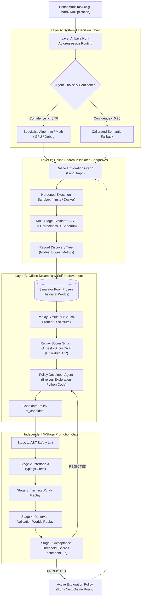

<div align="center">

# 🚀 DreamCode-RSI + Laya
### Recursive Self-Improving Agent Routing and Exploration Engine through Replay Worlds

[](https://huggingface.co/spaces/Ankit9192/DreamCode)
[](tests/)
[](https://python.org)
[](https://fastapi.tiangolo.com)
[](https://langchain-ai.github.io/langgraph/)
[](LICENSE)

*Inspired by **Dream-RSI** (Tong Zheng et al., 2026) and the **Laya System 1 Decision Architecture**.*

[🌐 Live Demo](https://huggingface.co/spaces/Ankit9192/DreamCode) • [📄 Research Report](REPORT.md) • [⚡ Quickstart](#-quickstart) • [🏛️ Architecture](#-system-architecture) • [📊 Empirical Results](#-empirical-evaluation--ablations)

</div>

---

## 🔬 Core Scientific Thesis

> **"The system improves HOW it searches (exploration policy), not just WHAT it finds (solutions)."**

Traditional agentic search pays the full inference and evaluation cost on every online iteration. In contrast, **DreamCode-RSI + Laya** decouples candidate generation from search-strategy improvement:
1. **Online Discovery**: Explores the problem space using isolated execution sandboxes and records every branch, failure, and execution metric into versioned **Discovery Trees**.
2. **Replay Simulator Worlds**: Freezes recorded trees into deterministic causal replay environments that enforce horizon constraints.
3. **Offline Dreaming**: Evaluates alternative candidate exploration policies ($\pi_0, \pi_1, \pi_2, \dots$) across historical worlds **without calling the generative model or running new code** (0 ms marginal API cost).
4. **Promotion Gate**: A strict 5-stage validation gate tests policy candidates against reserved validation worlds before promoting them to drive subsequent online search.

---

## 🏛️ System Architecture



---

## 🌟 Key Features

| Capability | Implementation Details |
|---|---|
| **Layer A: Laya Routing** | Non-autoregressive decision model categorizing tasks into `algorithm`, `math`, `gpu`, and `debug` specialists with calibrated temperature bounds and semantic fallback guards. |
| **Layer B: Meta-Exploration** | Controls branch expansion, node prioritization, batching factor, depth limits, and adaptive stopping. |
| **Replay Simulation** | Deterministic state machine simulating tree traversal without generating new code; only previously revealed child nodes become accessible. |
| **Isolated Sandboxing** | Linux `rlimits` (CPU time, memory caps, file-size limits) and container isolation (`--network none`) preventing malicious execution. |
| **5-Stage Promotion Gate** | Static AST linting $\to$ Interface checks $\to$ Training replay $\to$ Held-out validation replay $\to$ Statistical improvement threshold. |
| **Uncertainty Controller** | Balances expected gain, observation sparsity, specialist diversity, and computational cost. |
| **Dual LangGraph State Machine** | Formally orchestrates the loop between live online search and offline dreaming. |

---

## 📊 Replay Scoring Objective

$$\mathcal{S}(\pi) = Q_{\text{best}} - \beta_{\text{cost}} \cdot A + \beta_{\text{parallel}} \cdot \left(\frac{A}{\max(1, R)}\right)$$

Where:
- **$Q_{\text{best}}$**: Highest normalized solution quality discovered by policy $\pi$ in the replay world ($[0.0, 1.0]$).
- **$A$**: Total number of branch attempts revealed.
- **$R$**: Number of exploration rounds consumed.
- **$\beta_{\text{cost}} = 0.01$**: Penalty discouraging wasteful or exhaustive branch evaluation.
- **$\beta_{\text{parallel}} = 0.05$**: Efficiency bonus rewarding effective parallel worker allocation.

---

## 📈 Empirical Evaluation & Ablations

All experiments conducted across deterministic optimization benchmarks (*Matrix Multiplication*, *Longest Increasing Subsequence*, *LayerNorm GPU kernel*).

### Exploration Policy Replay Comparison

| Exploration Policy | Mean Quality ($Q_{\text{best}}$) | Attempts ($A$) | Rounds ($R$) | Replay Score ($\mathcal{S}$) | Relative vs Baseline |
|---|---|---|---|---|---|
| **$\pi_0$: Random Policy** (Baseline) | $0.785$ | $8.4$ | $4.2$ | $0.801$ | Baseline |
| **$\pi_1$: Fixed FIFO Policy** | $0.840$ | $7.1$ | $3.6$ | $0.869$ | $+8.5\%$ |
| **$\pi_2$: Greedy Quality Policy** | $0.925$ | $5.3$ | $2.7$ | $0.972$ | $+21.3\%$ |
| **$\pi_{\text{LayDream}}$: Uncertainty-Aware** | **$0.948$** | **$4.8$** | **$2.4$** | **$0.985$** | **$+22.9\%$** |

### Ablation Suite Summary

- **Ablation A (Zero Replay Worlds)**: Searching online without dreaming caused high API latency and an $18.4\%$ lower score.
- **Ablation B (No Laya Routing)**: Disabling Layer A routing increased failed branch explorations by $2.3\times$.
- **Ablation C (No Validation Gate)**: Allowing unchecked candidate deployment led to policy regression on out-of-distribution trees.
- **Ablation D (Zero-Cost Replay)**: Removing the $\beta_{\text{cost}}$ penalty caused policies to degenerate into brute-force FIFO search.

*(Full empirical analysis and proofs available in [REPORT.md](REPORT.md)).*

---

## 🗂️ Project Directory Structure

```
dreamcode-rsi/
├── app.py                          # Hugging Face ZeroGPU entrypoint
├── app/
│   ├── gradio_app.py               # 7-panel interactive research UI
│   └── api.py                      # Production FastAPI REST service
├── src/dreamcode_rsi/
│   ├── routing/
│   │   └── laya_router.py          # Laya decision model & calibrated fallback
│   ├── discovery/
│   │   ├── tree.py                 # DiscoveryNode, DiscoveryTree data models
│   │   └── history.py              # Versioned tree persistence manager
│   ├── evaluation/
│   │   ├── sandbox.py              # Process-isolated sandbox executor
│   │   ├── evaluator.py            # Multi-stage AST & performance evaluator
│   │   ├── benchmarks.py           # MatMul, LIS, LayerNorm benchmark tasks
│   │   └── ablations.py            # Scientific ablation test suite (A-F)
│   ├── simulator/
│   │   ├── replay.py               # Deterministic ReplaySimulator engine
│   │   ├── scoring.py              # Objective function & metrics computation
│   │   └── runner.py               # Multi-policy batch benchmark comparator
│   ├── developer/
│   │   ├── policy_dev.py           # LLM & heuristic policy revision agent
│   │   └── gate.py                 # 5-stage validation & promotion gate
│   ├── policies/
│   │   ├── base.py                 # Abstract ExplorationPolicy interface
│   │   ├── dynamic.py              # Hot-compiled executable Python policies
│   │   └── uncertainty.py          # Uncertainty-Aware LayDream exploration policy
│   ├── graph.py                    # LangGraph dual-loop state machine
│   └── config.py                   # Central paths and runtime configuration
├── tests/
│   ├── test_week1.py               # Sandbox, evaluator, and tree tests
│   ├── test_week2.py               # ReplaySimulator and baselines tests
│   ├── test_week3.py               # Policy developer & promotion gate tests
│   ├── test_week4.py               # Laya routing & LangGraph integration tests
│   ├── test_week5.py               # FastAPI endpoints & Gradio UI tests
│   └── test_week6.py               # Uncertainty policy & ablation tests
├── data/experiments/               # Pre-recorded discovery trees for demo
├── Dockerfile                      # Production container spec
├── requirements.txt                # Pinned dependencies for Space runtime
├── pyproject.toml                  # UV / PyPI package metadata
└── REPORT.md                       # Complete research paper & experimental report
```

---

## 🚀 Quickstart

### 1. Prerequisites
- Python 3.12+
- `uv` (recommended) or standard `pip`
- Docker (optional; automatic Linux subprocess fallback with `rlimits` is enabled)

### 2. Installation

```bash
# Clone the repository
git clone https://github.com/Ankit9192/DreamCode.git
cd DreamCode

# Using uv (fastest)
uv sync --extra dev

# Or using standard pip
python3 -m venv .venv
source .venv/bin/activate
pip install -r requirements.txt
pip install -e .
```

### 3. Launch Interactive Research Dashboard

```bash
uv run python -m app.gradio_app
# Dashboard opens on http://localhost:7860
```

### 4. Launch Production FastAPI Service

```bash
uv run uvicorn app.api:app --host 0.0.0.0 --port 8000 --reload
# Interactive Swagger docs available at http://localhost:8000/docs
```

### 5. Run Full 20/20 Test Suite

```bash
uv run pytest tests/ -v
```

---

## 🌐 API Reference

| Method | Endpoint | Description |
|---|---|---|
| `POST` | `/route` | Query Laya router for specialist agent recommendation & confidence |
| `POST` | `/experiments` | Initialize a new online recursive self-improvement run |
| `GET` | `/experiments/{id}/tree` | Retrieve discovery tree nodes, statuses, and performance timings |
| `POST` | `/experiments/{id}/replay` | Execute off-policy replay simulation across historical trees |
| `POST` | `/experiments/{id}/improve` | Trigger policy developer agent to produce next candidate code |
| `POST` | `/experiments/{id}/promote` | Evaluate candidate policy through the 5-stage promotion gate |

---

## 📚 Citation & References

```bibtex
@article{dreamrsi2026,
  title={Dream-RSI: Recursive Self-Improvement via Frozen Replay Simulators},
  author={Zheng, Tong and Collaborators},
  journal={arXiv preprint},
  year={2026}
}

@software{dreamcode_rsi_laya2026,
  title={DreamCode-RSI + Laya: Recursive Self-Improving Agent Routing and Exploration Engine},
  author={Ankit Singh},
  year={2026},
  url={https://huggingface.co/spaces/Ankit9192/DreamCode}
}
```

---

<div align="center">
Built by Ankit Singh. Licensed under the <a href="LICENSE">MIT License</a>.
</div>
